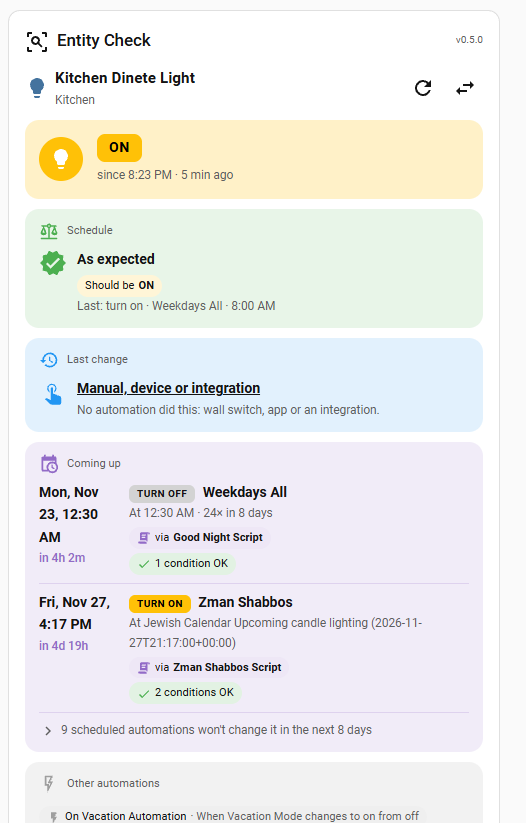
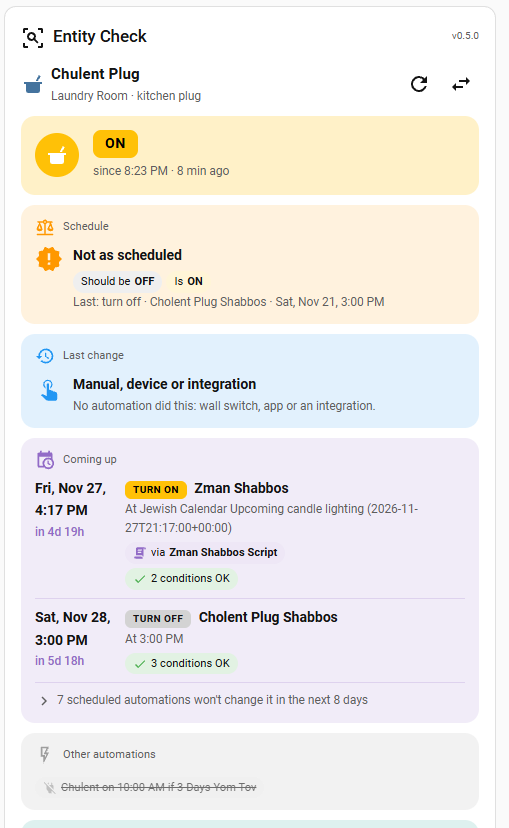
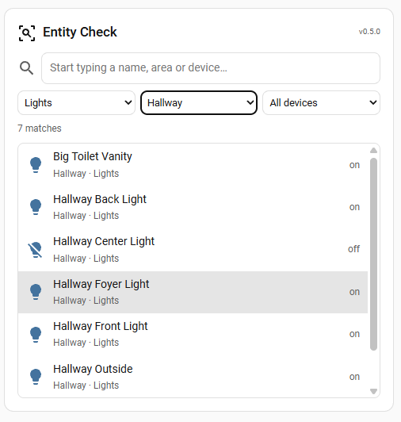

# Entity Check

A Home Assistant dashboard card that answers three questions about any light, switch or other entity:

1. **Why is it on (or off)?** Which automation changed it last, what triggered it, and which conditions passed.
2. **Should it be like this right now?** It combines all your time and sun based automations to work out what the state should be, and shows runs that were blocked (for example "vacation mode is on").
3. **When will it change next?** The upcoming scheduled runs, with their conditions checked.

You can also enter any date and time to see whether the entity should be on or off then, and which automations before and after decide it.

Pick an entity, read the answer, then pick another.

<p>
  
  
  
</p>

## Install

### HACS (custom repository)

1. HACS → ⋮ → **Custom repositories**.
2. Add this repository's URL, category **Dashboard**.
3. Install **Entity Check**, then reload your browser.

### Manual

1. Download `entity-check-card.js` from the latest release.
2. Copy it to `/config/www/entity-check-card.js`.
3. Settings → Dashboards → ⋮ → **Resources** → add `/local/entity-check-card.js` as a **JavaScript module**.

## Use

```yaml
type: custom:entity-check-card
```

All options can be set in the visual card editor. They are all optional:

| Option             | Description                                              | Default |
| ------------------ | -------------------------------------------------------- | ------- |
| `title`            | Card title                                               | `Entity Check` |
| `domains`          | Entity types offered in the picker                       | light, switch, fan, cover, lock, climate, media_player, input_boolean, valve, siren, humidifier, water_heater, vacuum |
| `areas`            | Only offer entities in these areas (area ids)            | all areas |
| `devices`          | Only offer entities of these devices (device ids)        | all devices |
| `include_entities` | Always offer these entities, even if filtered out        | none |
| `exclude_entities` | Never offer these entities                               | none |
| `entity`           | Entity to check when the card opens                      | none |

In the card itself, start typing to search by name, area or device, or narrow the list with the type, area and device filters. Press Enter to pick the first match.

## How it works and its limits

- Needs an **administrator** account, because it reads automation configs and run history (traces).
- It finds automations that act on the entity by entity, device, area, floor or label, including actions inside `choose` and `if` blocks.
- It follows **scripts** the automation runs (also scripts that run other scripts) and **scenes** (`scene.turn_on` and `scene.apply`), and shows "via <script or scene>".
- Automations and scripts made from **blueprints** are read with their inputs filled in.
- **Time**, **sun** and **time pattern** triggers can be predicted. Event based triggers (motion, someone arriving, a button press) can't. They are listed under "Can also change it".
- Conditions are checked like this:
  - time, sun and trigger-id conditions are calculated for the moment in question;
  - all other conditions (for example `input_boolean.vacation` is off) are tested by Home Assistant **as they are right now**, and marked "(as of right now)".
- Home Assistant keeps only the last 5 runs of each automation by default. Older runs can't be explained in detail. You can keep more with `trace: stored_traces: 20` in the automation.
- Changes made by a wall switch, the device's own app, or integrations such as Presence Simulation show as "Not changed by an automation".

## Development

```bash
npm install
npm test        # unit tests for the schedule logic
npm run build   # creates dist/entity-check-card.js
npm run watch   # rebuild on save
```

## License

MIT
